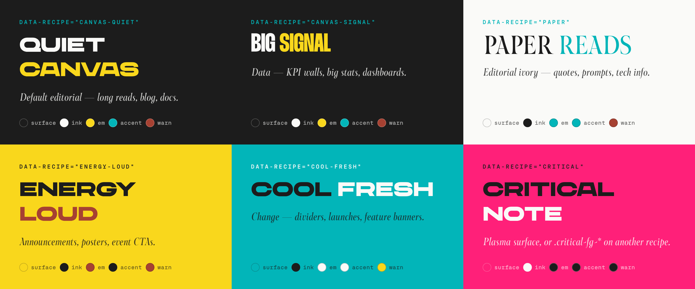
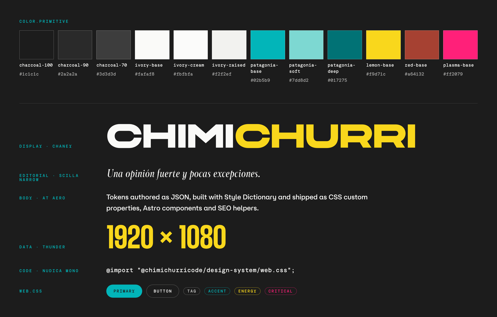

# Chimi design system

[](https://github.com/npatarino/cv-design-system/actions/workflows/ci.yml)

**`@chimichurricode/design-system`** — the single source of truth for colors, typography, recipes, shared Astro chrome and SEO used across the Chimichurri Code surfaces (talks, blog, brand book and the ecosystem webs).

Tokens are authored as JSON, built with [Style Dictionary v4](https://styledictionary.com/), and shipped as CSS custom properties. On top of them the package ships a web-scale stylesheet (`web.css`), the `@font-face` declarations and a build-time font fetcher (the licensed font files themselves live in a private repo, see [Fonts](#fonts)), Astro components (header, footer, theme toggle, brand marks, SEO head) and framework-agnostic SEO helpers.





## Contents

- [Quick start](#quick-start)
- [What's included](#whats-included)
- [Architecture](#architecture)
- [Recipes](#recipes)
- [Typography and naming](#typography-and-naming)
- [Theming (dark + light)](#theming-dark--light)
- [Responsive](#responsive)
- [Ecosystem chrome and SEO](#ecosystem-chrome-and-seo)
- [Fonts](#fonts)
- [Local development](#local-development)
- [Changing tokens](#changing-tokens)
- [Releasing](#releasing)
- [Status and known gaps](#status-and-known-gaps)

---

## Quick start

```bash
npm install @chimichurricode/design-system
```

### Astro web (what `cv-blog` does)

1. **CSS** — one import pulls in tokens, breakpoints, fonts, reset and utilities:

   ```css
   /* src/styles/global.css */
   @import "@chimichurricode/design-system/web.css";
   ```

2. **Fonts and SEO assets** — `fonts.css` points at `/fonts/*`, and `SEOHead` expects the favicons, `/og/<site>.webp`, `manifest.webmanifest` and `robots.txt` in `public/`. Put them there before building with the shipped scripts (the fonts come from a private repo, see [Fonts](#fonts)):

   ```jsonc
   // package.json
   "prebuild": "chimi-fetch-fonts public/fonts && node node_modules/@chimichurricode/design-system/scripts/seo-prebuild.mjs --site blog --public public"
   ```

3. **Breakpoints** — if your own CSS writes `@media (--md)`, inline the custom media at build time:

   ```js
   // postcss.config.mjs
   import { dsCustomMedia } from "@chimichurricode/design-system/postcss";
   export default { plugins: [...dsCustomMedia()] };
   ```

4. **Layout** — pick a recipe on `<body>`, bootstrap the theme in `<head>`, and use the shared chrome:

   ```astro
   ---
   import ThemeBootstrap from "@chimichurricode/design-system/ThemeBootstrap.astro";
   import SiteHeader from "@chimichurricode/design-system/SiteHeader.astro";
   import SiteFooter from "@chimichurricode/design-system/SiteFooter.astro";
   import SEOHead from "@chimichurricode/design-system/SEOHead.astro";
   ---
   <html lang="es">
     <head>
       <meta charset="utf-8" />
       <ThemeBootstrap />
       <SEOHead site="blog" title="My post" description="…" pathname={Astro.url.pathname} />
     </head>
     <body data-recipe="canvas-quiet">
       <SiteHeader brand={{ label: "Chimichurri Code", mark: "chimi", emText: "Code", href: "/" }} />
       <main>…</main>
       <SiteFooter />
     </body>
   </html>
   ```

   Component CSS then reads only `--recipe-*`:

   ```css
   .cta { background: var(--recipe-accent); color: var(--recipe-surface); }
   ```

### Slides (what `cv-talks` does)

Use the raw tokens without the web layer — `cv-talks` passthrough-copies `node_modules/@chimichurricode/design-system/dist` to `/design-system/` and links `tokens.css`. Each slide declares `recipe: <id>` in frontmatter and its layout reads `--recipe-*` plus the slide-scale `--chimi-type-*` composites. For the SEO head outside Astro, call `renderSEOHeadHTML(props)` from `@chimichurricode/design-system/seo/render-head`.

---

## What's included

| Import path | What it is |
|---|---|
| `web.css` | Everything a web needs: imports `dist/tokens.css`, `dist/breakpoints.css` and `fonts.css`, then adds a reset, web-scale type composites (`--web-display-xl`, `--web-body-md`, …), role tokens (`--muted`, `--hairline`, …) and utilities (`.container`, `.stack-{sm,md,lg}`, `.hide-on-mobile/-desktop`, `.display-*`, `.editorial-*`, `.eyebrow`, `.btn`, `.btn-primary`, `.tag`, …). |
| `tokens.css` → `dist/tokens.css` | Generated token variables + `[data-recipe]` selectors + the `:root[data-theme="light"]` overrides. No imports. |
| `dist/breakpoints.css` | Generated `--bp-{sm,md,lg,xl}` properties and matching `@custom-media` queries. |
| `fonts.css` | Hand-written `@font-face` for CHANEY, At Aero, Scilla Narrow, Thunder and Nudica Mono The font files are not in the package: see [Fonts](#fonts). |
| `postcss` | `dsCustomMedia()` — PostCSS plugins that inline `@media (--md)` etc. |
| `recipes` | `getTypeRecipes()` / `getTypeRecipeSummaries()` — type-family whitelist per recipe (from `tokens/type.recipe.json`). |
| `*.astro` | `SiteHeader`, `SiteFooter`, `SocialIcons`, `ThemeBootstrap`, `ThemeIcons`, `SEOHead`, `BrandMark`, `BrandFavicon`, `BrandLogoWordmark`, `BrandLogoCircle`. Astro 5, 6 or 7 is an optional peer dependency (`^5.0.0 || ^6.0.0 || ^7.0.0`). |
| `ecosystem` | `ECOSYSTEM_SITES` (sites shown in the cross-web chrome), `DEFAULT_SOCIALS`, `ecosystemLinksExcluding()`. |
| `site-registry`, `site-registry-runtime` | The canonical list of sites (`getSite`, `findSite`, `sitesWithRole("chrome" \| "seo")`) and its generated runtime copy. |
| `seo`, `seo/*` | `buildJsonLd`, `defaultsForSite`, `renderSEOHeadHTML`, sitemap / robots / manifest renderers. See [`seo/README.md`](seo/README.md). |
| `assets/logos/*`, `assets/icons/*`, `assets/og/*` | Brand logos, the icon set and per-site OG images. |
| `scripts/*.mjs` (shipped) | Node CLIs a consumer runs from `node_modules/@chimichurricode/design-system/scripts/` — see [Consumer scripts](#consumer-scripts). |

The full map is the `exports` field in [`package.json`](package.json).

---

## Architecture

Three layers, consumed top-down. Each layer may only reference the one above it.

```
1. PRIMITIVES  tokens/*.primitive.json — raw hex, font stacks, sizes, breakpoints.
               Not consumed by surfaces, except --bp-* / @media (--md) and a
               documented --chimi-primitives-color-* escape hatch for fixed
               local palettes (duotone logos, brand marks).
2. RECIPES     tokens/color.recipe.json — 6 closed surface+ink+em+accent+warn
               combos, with per-theme overrides. THE layer slides and webs consume,
               via data-recipe="<id>" → --recipe-{surface,ink,em,accent,warn}.
3. UTILITIES   web.css — web-scale type composites + layout/utility classes.
               Webs only; slides keep their own slide-scale typography.
```

Why: before this package, colors and fonts were duplicated across brand and talks, and the *meaning* of a value (what is `--lemon` for?) lived in people's heads. Now every value lives in one JSON file and every role has a name — changing the dark canvas is one edit in `color.recipe.json`, no layout CSS changes.

Escape-hatch uses of primitives carry an inline `/* primitive escape hatch — <reason> */` comment.

```
tokens/   color.primitive · color.recipe · font.primitive · font.semantic ·
          size.primitive · breakpoint.primitive · type-style.semantic ·
          type.recipe (metadata only, not emitted to CSS)
dist/     tokens.css · breakpoints.css            (generated, git-ignored)
components/  Astro components + ecosystem.ts
seo/      SEO helpers + seo/README.md
docs/     recipes · theming · responsive · ecosystem-chrome · anti-patterns · gaps
openspec/ archived change proposals (openspec/changes/archive/)
config.mjs   Style Dictionary build
```

---

## Recipes

A recipe is a closed combination of five color roles plus a typography whitelist. A surface declares one — `<body data-recipe="paper">` or slide frontmatter `recipe: paper` — and reads only `--recipe-*`. There are exactly six ways to color a Chimi surface:

| Recipe | Use |
|---|---|
| `canvas-quiet` | Default editorial — long reads, blog, docs, dense slides. |
| `canvas-signal` | Data — KPI walls, big stats, dashboards. |
| `paper` | Editorial ivory — quotes, prompts, technical info. |
| `energy-loud` | Announcements, posters, event CTAs. Lemon leads; rule of one per page. |
| `cool-fresh` | Change — dividers, launches, feature banners. |
| `critical` | Plasma surface. On top of another recipe, use `.critical-fg-{stat,quote,eyebrow,marker,display-word}` to plasma a single role. |

Field guide: [`docs/recipes.md`](docs/recipes.md). What every surface avoids: [`docs/anti-patterns.md`](docs/anti-patterns.md).

---

## Typography and naming

Five families (`font.semantic.json`): **display** CHANEY · **body** At Aero · **editorial** Scilla Narrow · **data** Thunder · **code** Nudica Mono.

CSS variables follow `--chimi-{category}-{role}-{variant}`:

| JSON path | CSS variable |
|---|---|
| `color.recipe.canvas-quiet.surface` | `--chimi-color-recipe-canvas-quiet-surface` |
| `color.primitive.charcoal.100` | `--chimi-primitives-color-charcoal-100` |
| `font.family.display` | `--chimi-font-family-display` |
| `type.display.md.fontSize` | `--chimi-type-display-md-fontSize` |
| *(shorthand)* `type.display.md` | `--chimi-type-display-md` |
| *(consumer-facing)* | `--recipe-{surface,ink,em,accent,warn}` |

The `font:` shorthand composites are the most useful; letter-spacing and text-transform aren't part of `font:`, so apply them alongside:

```css
.s-my-slide h2 {
  font: var(--chimi-type-display-md);
  letter-spacing: var(--chimi-type-display-md-letterSpacing);
}
```

`--chimi-type-*` is slide-scale (1920×1080). Webs use the `--web-*` composites or the `.display-*` / `.editorial-*` / `.body-lg` classes from `web.css`.

---

## Theming (dark + light)

The token cascade's default is **dark**; `<html data-theme="light">` applies the light overrides (today only `surface`, `ink` and `em` of `canvas-quiet` and `canvas-signal` flip). `<ThemeBootstrap />` makes **light the effective default on webs**: it applies the saved `chimi-theme` choice, otherwise follows `prefers-color-scheme`, and writes `data-theme="light"` unless the user wants dark. Talks and brand don't include it and stay dark. `<SiteHeader />` renders the toggle (`themeToggle` prop).

Full contract: [`docs/theming.md`](docs/theming.md).

---

## Responsive

Mobile-first against four breakpoints — `--bp-sm` 480, `--bp-md` 768, `--bp-lg` 1024, `--bp-xl` 1280 — each also a `@custom-media` query:

```css
.feed { display: grid; grid-template-columns: 1fr; gap: var(--stack-sm); }
@media (--md) {
  .feed { grid-template-columns: repeat(3, 1fr); gap: var(--stack-md); }
}
```

Consumer CSS needs the `dsCustomMedia()` PostCSS helper (see [Quick start](#quick-start)); `web.css` and the components ship literal queries and need no tooling. The only `max-width` rule allowed is the `(max-width: 767.98px)` floor that pins buttons and nav links to 44×44 tap targets. Details: [`docs/responsive.md`](docs/responsive.md).

---

## Ecosystem chrome and SEO

`SiteHeader` (brand mark, nav, theme toggle, socials) and `SiteFooter` (`rich` / `minimal`) stitch the ecosystem webs together; the list of linked sites comes from `site-registry.ts` (`ECOSYSTEM_SITES` = sites with `chrome: true`, currently 9; SEO covers 11 including `talks` and `brand`). Field guide: [`docs/ecosystem-chrome.md`](docs/ecosystem-chrome.md).

The sibling-site logos in the footer (`logoSrc` in the registry, e.g. Simple Scrum Poker's mark) are resolved by `SiteFooter` to the SVGs in `assets/logos/<id>/` and bundled by Vite, so consumers don't copy any `/logos/` files.

`SEOHead` (Astro) and `renderSEOHeadHTML()` (anything else) emit the whole head block — title, description, canonical, OG, Twitter, favicons, manifest, theme color, ecosystem alternates and JSON-LD — from the per-site defaults in [`seo/defaults.mjs`](seo/defaults.mjs). See [`seo/README.md`](seo/README.md).

---

## Fonts

The five typefaces (CHANEY, At Aero, Scilla Narrow, Thunder, Nudica Mono) are **licensed fonts that can't be redistributed**, so they are not in this repository or in the npm package (from 0.8.1). They live in the private repo [`npatarino/cv-fonts`](https://github.com/npatarino/cv-fonts) (`fonts/`). This package ships only `fonts.css` (the `@font-face` rules, pointing at `/fonts/<file>`) and `scripts/fetch-fonts.mjs`, which copies the files into a site at build time:

```jsonc
// package.json of a site
"prebuild": "chimi-fetch-fonts public/fonts"
```

```js
// or from a script
import { fetchFonts } from "@chimichurricode/design-system/fetch-fonts";
await fetchFonts({ outDir: "public/fonts" });
```

Where the files come from (first match wins):

| Source | When |
|---|---|
| `CHIMI_FONTS_DIR` | A local directory with the files, e.g. `CHIMI_FONTS_DIR=~/code/cv-fonts/fonts` for local dev with a clone of `cv-fonts`. |
| `CHIMI_FONTS_TOKEN` | A fine-grained GitHub token with **Contents: read-only** on `npatarino/cv-fonts` only. Downloads the repo tarball (`CHIMI_FONTS_REF`, default `main`) and extracts `fonts/*`. Cached in `node_modules/.cache/chimi-fonts/<ref>`; a branch is re-downloaded after `CHIMI_FONTS_CACHE_HOURS` (default 24). Set it in each site's Vercel project (Production and Preview) and, if CI should build with the real fonts, as a GitHub Actions secret. |
| Legacy | An installed `@chimichurricode/design-system` ≤ 0.8.0 still has `assets/fonts/`; used with a warning. |
| None | The build succeeds with a warning and the site falls back to system fonts. `--require` or `CHIMI_FONTS_REQUIRED=1` turns this into an error. |

Files that are already identical in the target aren't rewritten, the target should be gitignored (`public/fonts/`), and the token is never printed. The fetcher has no dependencies (Node ≥ 18: `fetch`, `zlib` and a small tar reader). Tests: `bun run test`.

`.gitignore` blocks `assets/fonts/` and font extensions so they can't be committed here again. Versions ≤ 0.8.0 on npm still contain the files; see [Releasing](#releasing) for the deprecation workflow.

## Local development

Requires [Bun](https://bun.sh/) (the build scripts run with `bun`).

```bash
bun install
bun run build                  # emit seo/site-registry-runtime.generated.mjs, then dist/tokens.css + dist/breakpoints.css
bun run check                  # registry drift, SiteId unions and the ecosystem catalog (incl. logo files)
bun run generate:icons         # favicon / touch / manifest icons from assets/logos/favicon.svg (sharp)
bun run generate:icon-preview  # rebuild assets/icons/preview.html
```

`dist/` is git-ignored, so run `bun run build` after cloning — `web.css` and the `postcss` helper import from it.

To try changes in a consumer before publishing, link the package (`bun link` / `npm link`) or point the consumer's dependency at a local path.

### Consumer scripts

Shipped in the package and run from the consumer's root:

| Script | What it does |
|---|---|
| `scripts/fetch-fonts.mjs [target] [--require]` (bin `chimi-fetch-fonts`, import `@chimichurricode/design-system/fetch-fonts`) | Puts the licensed font files into `target` (default `public/fonts`). See [Fonts](#fonts). |
| `scripts/sync-dir.mjs <assets-subdir> <target>` | Copies a directory from `assets/` (e.g. `icons public/icons`). |
| `scripts/copy-asset.mjs <package-path> <target>` | Copies one file from the package. |
| `scripts/seo-prebuild.mjs --site <id> [--public public]` | Writes favicons, `og/<id>.webp`, `manifest.webmanifest` and `robots.txt` into `public/`. `--disallow`, `--noindex`, `--sitemap`, `--no-*` flags. |
| `scripts/check-seo.mjs --site <id> [--dir dist]` | Lints the built HTML, sitemap and robots against the cross-web SEO contract. Exits 1 on errors. |
| `scripts/check-slop.mjs [dir]` | Reports "template look" patterns (see [`docs/anti-patterns.md`](docs/anti-patterns.md)). Never fails. |

The scripts that only made sense in the old monorepo (`check-recipes`, `check-docs-linter-coherence`, `check-workspace-conventions`, `process-icons`, `generate-og`) were removed; they're in the git history.

---

## Changing tokens

1. Edit the JSON in `tokens/`.
2. `bun run build` and check `dist/tokens.css`.
3. Commit the JSON (not `dist/`).

Before adding a role, ask: is it really new, or a variant of an existing one? Will more than one surface use it? One-off values belong in the layout. Don't add primitives unless a genuinely new brand color enters the system — and never invent a seventh recipe ad hoc.

---

## Releasing

Published to npm as [`@chimichurricode/design-system`](https://www.npmjs.com/package/@chimichurricode/design-system) (semver, `0.x`). Only the paths in `package.json` → `files` are shipped — of `scripts/`, only the [consumer scripts](#consumer-scripts).

1. Bump `version` in `package.json` and add an entry to [`CHANGELOG.md`](CHANGELOG.md).
2. Merge to `main`.
3. [`.github/workflows/release.yml`](.github/workflows/release.yml) runs on pushes to `main` that touch `package.json` (or by hand: Actions → Release → Run workflow). It runs `bun run build` and `bun run check`, and if `npm view @chimichurricode/design-system@<version>` doesn't find the version, it runs `npm publish --access public --provenance`, tags `v<version>` and creates a GitHub Release with generated notes. A version already on npm is skipped, so re-running is safe.

**Required secret: `NPM_TOKEN`** (repo Settings → Secrets and variables → Actions). Create it on npmjs.com → Access Tokens → Generate New Token → *Granular Access Token*: packages and scopes `@chimichurricode/*` (or this package), permission *Read and write*. If the account requires 2FA for publishing, enable *Bypass two-factor authentication* on the token (granular tokens with that option, and legacy *Automation* tokens, publish without an OTP). Without the secret, a push to `main` skips the release with a notice and a manual run fails with an error saying what to add.

More secure alternative, no token: [npm Trusted Publishing](https://docs.npmjs.com/trusted-publishers). On npmjs.com → the package → Settings → Trusted Publisher → GitHub Actions, enter owner `npatarino`, repository `cv-design-system` and workflow `release.yml`; then set the repository **variable** `NPM_TRUSTED_PUBLISHING=true` so the workflow runs without `NPM_TOKEN`.

Publishing by hand still works (`bun run build && bun run check && npm publish`, with a 2FA OTP). `dist/` must exist: it's in the tarball but not in git.

**Deprecating the versions that bundled the fonts.** Versions ≤ 0.8.0 contain the licensed font files. Once 0.8.1 is on npm, run Actions → *Deprecate font versions* → Run workflow ([`.github/workflows/deprecate-font-versions.yml`](.github/workflows/deprecate-font-versions.yml), manual only, uses the same `NPM_TOKEN`). It checks that 0.8.1 is published (and fails otherwise) and then runs `npm deprecate "@chimichurricode/design-system@<=0.8.0" "…"` so installs of those versions warn and point to ≥ 0.8.1. Deprecating doesn't remove the tarballs from npm; unpublishing is a separate decision (npm only allows it within 72 h or for packages without dependents).

Consumers pin a caret range (`cv-blog` `^0.8.0`, `cv-brand` `^0.7.5`, `cv-talks` `^0.7.6`), so bump them after a minor release.

---

## Status and known gaps

Fixed in 0.8.1: the footer no longer requests `/logos/simple-scrum-poker/favicon{,-dark}.svg` from each consumer (404 on every site that didn't copy them); `check-seo`, `seo-prebuild`, `sync-dir` and `copy-asset` work from `node_modules` and are shipped; `check-ecosystem-chrome` derives from the registry; the dead monorepo scripts are gone; the licensed fonts are out of the package (fetched at build time, see [Fonts](#fonts)).

Still open:

- Spacing isn't tokenized yet (`--stack-*` lives in `web.css`, raw px elsewhere) — see [`docs/gaps.md`](docs/gaps.md).
- The talks mobile viewer uses viewport units rather than DS breakpoints, so `dist/breakpoints.css` is webs-only today.
- Few automated tests: the monorepo's `node:test` suites weren't carried over. `bun run check` covers the registry and catalog contracts, and `bun run test` the font fetcher.
- `docs/anti-patterns.md` and parts of `docs/recipes.md` are still in Spanish.

## License

No license is declared yet (no `LICENSE` file and no `license` field in `package.json`). The typefaces are third-party licensed fonts and are not part of this repository or the package (see [Fonts](#fonts)).
